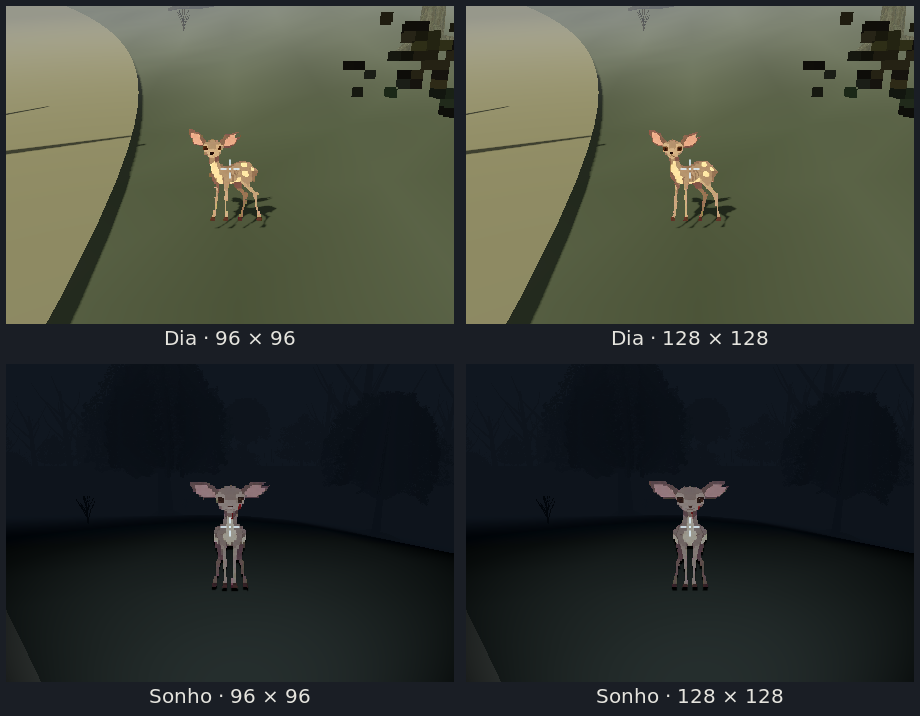

# Cervo de Attis — arte e animação

O filhote tem pernas longas, aspecto franzino, orelhas grandes e pelagem clara com manchas. A arte aproxima sua silhueta da de um cervo terrestre. Os quadros de pastoreio, alerta, fuga de costas e observação distinguem estados de comportamento. O sorriso e as manchas de sangue das poses frontais do sonho preservam a identidade do filhote. O cervo permanece silencioso.

A cena da espécie usa o conjunto de 96 pixels e define a escala visual em 1,7. No editor, F7 alterna entre 96 e 128 pixels em Attis. A comparação abaixo mostra as duas resoluções.

**Referência no projeto** — `scenes/entities/npcs/deer.tscn` e `scripts/entities/npcs/deer_billboard.gd`.
