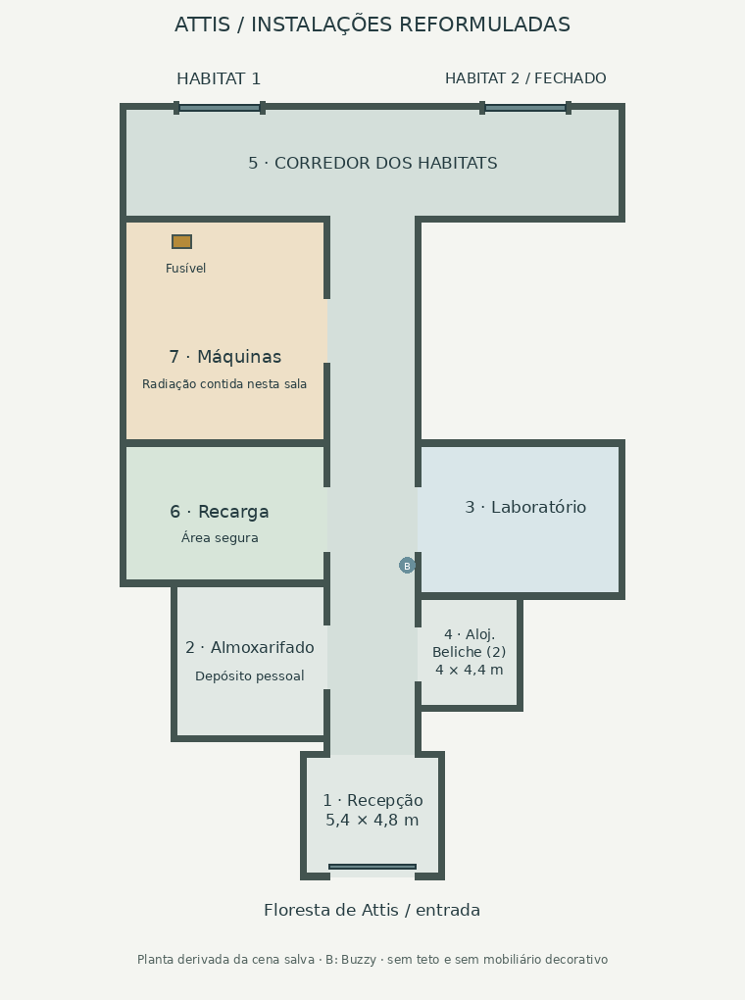

# Planta das instalações

A imagem foi derivada da geometria salva da cena pelo script `scripts/world/tools/export_interior_plan.py`; teto e mobiliário decorativo foram omitidos para leitura. A indicação “Fusível” identifica o painel onde a peça é instalada. O pesquisador já traz a peça na mochila ao chegar à reserva.

| Nº | Ambiente | Configuração atual |
|---|---|---|
| 1 | Recepção | 5,4 × 4,8 m, um balcão curto e assento; ligada diretamente à saída da floresta e ao corredor central. |
| 2 | Almoxarifado | Adubo, depósito pessoal e prateleiras, perto da entrada para facilitar abastecimento. |
| 3 | Laboratório | A bancada principal registra coletores cheios por origem. Os dois coletores começam na bancada auxiliar. |
| 4 | Alojamento | 4 × 4,4 m, beliche para duas pessoas, armário e mesa pequena. A cama mantém as regras de descanso e checkpoint. |
| 5 | Corredor dos habitats | Corredor transversal, dentro da mesma cena, com as portas H1/H2 alinhadas à parede do fundo. Sem elevador nem sala de transferência. |
| 6 | Recarga segura | Próxima das máquinas, com acesso próprio pelo corredor; mantém o ponto de retorno do robô e fica fora da radiação. |
| 7 | Máquinas | Sala lateral própria com painel de fusível, puzzle 2D, geradores e radiação restrita ao ambiente. O painel deixou o eixo/final do corredor. |

**Porta H1:** transição de ida e volta entre as instalações e a terceira área jogável, Habitat 1.

**Porta H2:** continua fechada e informa acesso bloqueado. Não é o painel de energia e não está no meio de uma sala.

Buzzy permanece no corredor central. Tubulações, vigas, calhas de luz, ventilação, armários e faixas de segurança dão caráter industrial/laboratorial com materiais simples, sem texturas novas. A cena não reconstrói o layout durante a partida.
